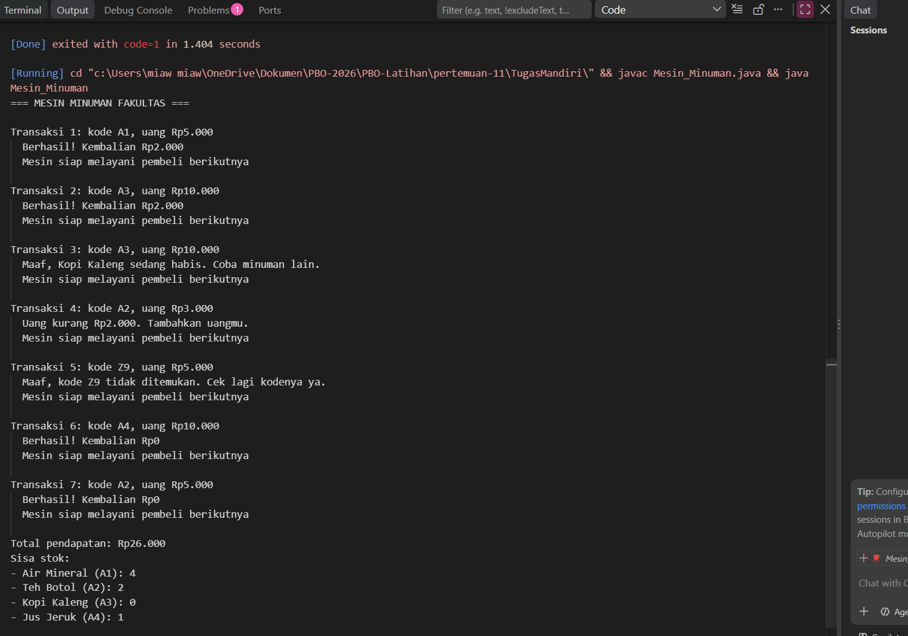
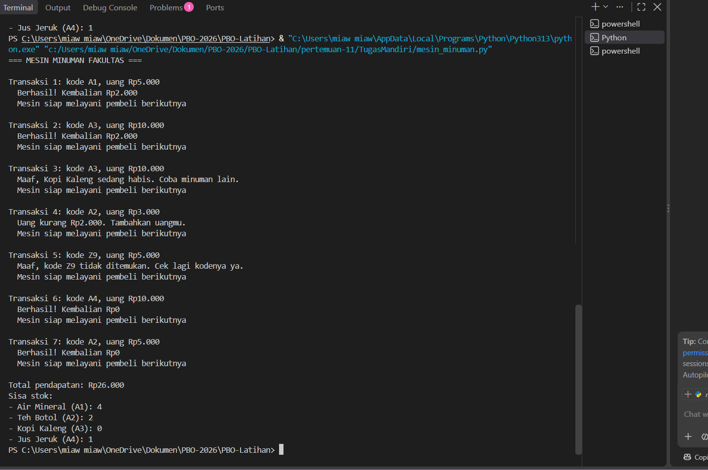

# Tugas Mandiri: Mesin Penjual Minuman di Gedung Kuliah

Simulasi mesin penjual minuman otomatis dengan exception handling yang rapi.
Tersedia dalam dua versi: **Python** dan **Java**.

| | |
|---|---|
| **Nama** | _Luvita Khairana Salwa_ |
| **NIM** | _2509106041_ |
| **Mata Kuliah** | Pemrograman Berorientasi Objek |
| **Pertemuan** | 11, Exception Handling |

## Isi Proyek

```
.
├── mesin_minuman.py        # versi Python
├── Mesin_Minuman.java      # versi Java
├── screenshot/
│   ├── output_java.png     # tangkapan layar output Java
│   └── output_python.png   # tangkapan layar output Python
└── README.md
```

## Cara Menjalankan

**Python** (3.8 atau lebih baru):

```bash
python mesin_minuman.py
```

**Java** (JDK 11 atau lebih baru):

```bash
javac Mesin_Minuman.java
java Mesin_Minuman
```

> Nama file Java harus sama persis dengan nama class publik: `Mesin_Minuman.java`.

## Desain Program

### Kelas

| Kelas | Tanggung jawab |
|---|---|
| `Produk` | Menyimpan kode, nama, harga, dan stok satu minuman. |
| `MesinMinuman` | Menyimpan daftar produk dan total pendapatan; method `beli(kode, uang)` memproses transaksi. |

Mesin diisi empat produk: Air Mineral (A1), Teh Botol (A2), Kopi Kaleng (A3, stok hanya 1), dan Jus Jeruk (A4).

### Hierarki Exception

```
MesinError (Java: MesinException)
├── ProdukTidakAdaError   -> membawa kode
├── StokHabisError        -> membawa nama produk
└── UangKurangError       -> membawa kekurangan uang
```

Data tambahan disimpan sebagai atribut exception, sehingga pesan ke pembeli
(misalnya "uang kurang Rp2.000") diambil dari exception, bukan ditulis manual.

### Checked atau Unchecked (Java)

Dipilih **checked exception** (turunan `Exception`). Transaksi gagal karena stok
habis atau uang kurang adalah kondisi bisnis yang wajar, bukan bug program,
sehingga compiler memaksa pemanggil `beli()` untuk menanganinya.

### Alur `beli(kode, uang)`

1. Cari produk. Jika tidak ada, lempar `ProdukTidakAdaError`.
2. Jika stok 0, lempar `StokHabisError`.
3. Jika uang kurang dari harga, lempar `UangKurangError(harga - uang)`.
4. Hanya setelah ketiga pengecekan lolos: kurangi stok, tambah pendapatan,
   lalu kembalikan `uang - harga`.

Dengan urutan ini, **stok dan pendapatan tidak berubah jika transaksi gagal**.

### Penanganan di Program Utama

Setiap transaksi memakai satu blok `try / except (catch) / finally`:

- Tiga penangkap turunan diletakkan **lebih dulu**, masing-masing dengan pesan ramah.
- `except MesinError` (Java: `catch (MesinException)`) diletakkan **paling bawah**
  sebagai jaring pengaman. Jika diletakkan di atas, ia akan menelan semua
  turunan dan pesan ramah tidak pernah tampil.
- `finally` mencetak `Mesin siap melayani pembeli berikutnya` setelah setiap
  transaksi, baik berhasil maupun gagal.
- Tidak ada exception yang ditelan diam-diam; setiap kegagalan menghasilkan pesan.

## Skenario Pengujian

| No | Kode | Uang | Hasil yang diharapkan |
|---|---|---|---|
| 1 | A1 | Rp5.000 | Berhasil, kembalian Rp2.000 |
| 2 | A3 | Rp10.000 | Berhasil, kembalian Rp2.000, stok jadi 0 |
| 3 | A3 | Rp10.000 | Gagal: stok habis |
| 4 | A2 | Rp3.000 | Gagal: uang kurang Rp2.000 |
| 5 | Z9 | Rp5.000 | Gagal: produk tidak ada |
| 6 | A4 | Rp10.000 | Berhasil, kembalian Rp0 |
| 7 | A2 | Rp5.000 | Berhasil, kembalian Rp0 |

## Contoh Output

```
=== MESIN MINUMAN FAKULTAS ===

Transaksi 1: kode A1, uang Rp5.000
  Berhasil! Kembalian Rp2.000
  Mesin siap melayani pembeli berikutnya

Transaksi 3: kode A3, uang Rp10.000
  Maaf, Kopi Kaleng sedang habis. Coba minuman lain.
  Mesin siap melayani pembeli berikutnya

Transaksi 4: kode A2, uang Rp3.000
  Uang kurang Rp2.000. Tambahkan uangmu.
  Mesin siap melayani pembeli berikutnya

...

Total pendapatan: Rp26.000
Sisa stok:
- Air Mineral (A1): 4
- Teh Botol (A2): 2
- Kopi Kaleng (A3): 0
- Jus Jeruk (A4): 1
```

## Tangkapan Layar

### Versi Java



### Versi Python



